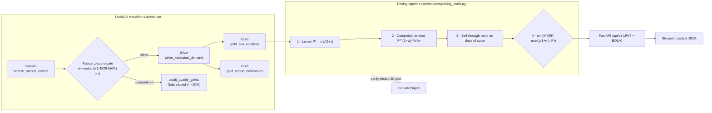

# ⚡ Real-Time Dynamic Pricing & Unit Economics Engine

[](https://github.com/samuelhtampubolon/dynamic-pricing-engine/actions/workflows/ci.yml)
[](https://www.python.org/downloads/)
[](https://fastapi.tiangolo.com)
[](https://duckdb.org)
[](SECURITY.md)
[](tests/)

A locally runnable pricing and unit economics engine: **FastAPI** gateway, embedded **DuckDB Medallion Lakehouse** (Bronze → Silver → Gold), **log-log OLS elasticity** with full inference, a **Lerner-optimal price pipeline behind a non-bypassable margin-floor / MSRP circuit breaker**, **Thompson Sampling / UCB1 / ε-greedy** price experimentation, cohort **LTV/CAC** economics and a **Streamlit** control tower.

## 🌐 Live demo

- **Repository**: <https://github.com/samuelhtampubolon/dynamic-pricing-engine>
- **Interactive GitHub Pages**: **<https://samuelhtampubolon.github.io/dynamic-pricing-engine/>**

The Pages site runs the same math as the API in the browser (`docs/assets/js/engine.js`, kept in lock-step with Python by `tests/test_js_engine_parity.py`). It has seven sections: Guarded Quote Simulator, Econometric Elasticity Studio, Bandit Arena, Cohort Ledger, Formula Audit, Lakehouse & Anti-Poisoning demo, and Security. Every asset (fonts, KaTeX, Chart.js) is self-hosted under a `script-src 'self'` Content-Security-Policy.

---

## 🏛️ Architecture



Serving processes attach to DuckDB **read-only** (`DUCKDB_READ_ONLY=true`), so the API and the cockpit share one file without lock collisions. Only the preflight step (`run_local.py --check`) opens it read-write, before the servers start.

---

## 📐 Quantitative model

### Pricing pipeline

| Stage | Formula | Notes |
| :--- | :--- | :--- |
| Demand | $\mathbb{E}[Q] = S\cdot s\cdot e^{\alpha}P^{\varepsilon}P_c^{\beta}$ | $S$ = Duan smearing, $s$ = demand surge factor |
| Unconstrained optimum | $P^* = c\,\frac{\varepsilon}{1+\varepsilon}$ for $\varepsilon<-1$ | Inelastic ($-1\le\varepsilon<0$): corner at MSRP |
| Lerner index | $L = \frac{P-c}{P} = -\frac{1}{\varepsilon}$ | reported at $P^*$ and at the final price |
| Competitor anchor | $P_a = P^{*\,1-w}P_c^{\,w}$, $w=0.30$ | explicit, bounded policy |
| Days of cover | $\text{DoC} = I / \mathbb{E}[Q(P_a)]$ | band $[7, 45]$ days |
| Sell-through price | $P_i = P_a\left(\frac{I}{Q(P_a)\,T}\right)^{1/\varepsilon}$ | only when DoC leaves the band |
| **Circuit breaker** | $P_{rec} = \min(\text{MSRP}, \max(c(1+m), P_i))$ | non-bypassable; NaN fails closed; floor > MSRP → HTTP 409 |
| Profit uplift | $\Delta\Pi\% = \frac{P_1-c}{P_0-c}\left(\frac{P_1}{P_0}\right)^{\varepsilon}-1$ | vs. the static base price |
| Break-even volume | $\Delta Q\% = \frac{-\Delta P\%}{CM\%+\Delta P\%}$ | volume needed to hold gross profit |
| Markup ↔ margin | $g = \frac{m}{1+m}$ | the 22% floor on the GPU SKU is an 18.0% gross margin |

### Econometrics (`fit_log_log_ols`)

$\ln Q_t = \alpha + \varepsilon\ln P_t + \beta\ln P^c_t + \sum_{d=1}^{6}\gamma_d D_{d,t} + u_t$, with standard errors $s^2(X'X)^{-1}$, t-statistics, p-values, 95% CIs, adjusted $R^2$, Durbin-Watson, VIF for $\ln P$, AIC/BIC and the smearing factor $S=\frac1n\sum e^{\hat u_t}$.

### Experimentation (`run_bandit`)

Poisson demand from the fitted curve, reward $(P-c)Q$. Thompson Sampling $\theta_i\sim\mathcal N(\bar x_i, s^2/n_i)$, UCB1 $\bar x_i + s\sqrt{2\ln t/n_i}$, ε-greedy. Pseudo-regret $R_T=\sum_t(\mu^*-\mu_{a_t})$ against the static price. Seeded and reproducible.

### Unit economics

| Metric | Formula |
| :--- | :--- |
| LTV | $m/c$, $m = \text{ARPU}\cdot\text{GM}$ |
| Discounted LTV | $m/(c+d)$, $d = (1+d_a)^{1/12}-1$ |
| LTV/CAC (portfolio) | $\sum N_j\text{LTV}_j / \sum N_j\text{CAC}_j$ (customer-weighted) |
| Payback | $\text{CAC}/m$ |
| Churn-adjusted payback | $\ln(1-\text{CAC}\,c/m)/\ln(1-c)$; *never* if $\text{CAC}\ge m/c$ |
| Annual churn, lifetime, half-life | $1-(1-c)^{12}$, $1/c$, $\ln 0.5/\ln(1-c)$ |

The [Formula Audit section of the live site](https://samuelhtampubolon.github.io/dynamic-pricing-engine/#formulas) tags all 32 formulas as verified, corrected or new, and lists the v1 defects that v2 fixes.

---

## 🛡️ Security

See [SECURITY.md](SECURITY.md) for the full control list. Highlights:

- **API1 BOLA**: tenant comes from the verified JWT; cross-tenant requests get 403 without echoing tenant IDs.
- **API2 Authentication**: client secrets verified against scrypt hashes in constant time; short-lived JWTs with pinned algorithm and required `iss`, `aud`, `exp`, `nbf`, `iat`, `jti`; no default signing key.
- **API3 Mass assignment**: `extra='forbid'` and `allow_inf_nan=False` everywhere; role is server-assigned.
- **API4 Resource consumption**: horizon ≤ 5,000, 32 KB body cap, per-route rate limits, 10/min on `/auth/token`.
- **API8 Misconfiguration**: CSP, HSTS, `X-Frame-Options: DENY`, `nosniff`, COOP/CORP, `Cache-Control: no-store`, CORS allow-list, TrustedHost, Swagger off in production.
- **Data poisoning**: robust z-score gate with a fail-closed quarantine ratio.

---

## 🚀 Quickstart

```bash
pip install -r requirements.txt
python run_local.py --check   # seed/migrate lakehouse, P95 latency, 1,000-case guardrail fuzz, ports
python run_local.py           # FastAPI + Streamlit, both attached read-only
```

- Streamlit cockpit: <http://127.0.0.1:8501>
- Swagger UI: <http://127.0.0.1:8000/docs> · ReDoc: <http://127.0.0.1:8000/redoc>
- Probes: <http://127.0.0.1:8000/healthz>, <http://127.0.0.1:8000/readyz>

### Calling the API locally

Outside production, two local demo tenants are available (`tenant_alpha` / `alpha-local-demo-secret`, `tenant_beta` / `beta-local-demo-secret`) and the JWT key is ephemeral per process. These secrets are public, so the app refuses to start with them unless `HOST` is a loopback address (`127.0.0.1`, `localhost`, `::1`).

```bash
TOKEN=$(curl -s -X POST http://127.0.0.1:8000/api/v1/auth/token \
  -H 'content-type: application/json' \
  -d '{"tenant_id":"tenant_alpha","client_secret":"alpha-local-demo-secret"}' | python -c "import sys,json;print(json.load(sys.stdin)['access_token'])")

curl -s -X POST http://127.0.0.1:8000/api/v1/pricing/quote \
  -H "Authorization: Bearer $TOKEN" -H 'content-type: application/json' \
  -d '{"tenant_id":"tenant_alpha","sku_id":"SKU-GPU-H100","inventory_level":120,"competitor_price":30500}'
```

### Production configuration

```bash
python -c "import secrets; print(secrets.token_urlsafe(48))"   # JWT_SECRET_KEY
python -m src.credentials hash-secret                         # one scrypt hash per tenant
```

Set `APP_ENV=production`, `JWT_SECRET_KEY` and `TENANT_CREDENTIALS=tenant_id:role:scrypt$...` in `.env` (see [.env.example](.env.example)). The process refuses to start in production without them. `docker compose up` always runs the API with `APP_ENV=production`, builds a non-root image with a read-only root filesystem, binds ports to loopback only, and reads secrets from `.env`.

### Upgrading from v1

`data/pricing_lakehouse.duckdb` is no longer tracked by git. If `git pull` complains about it, delete the local file (`rm data/pricing_lakehouse.duckdb`) and run `python run_local.py --check`, which recreates and migrates it.

---

## 🧪 Verification

```bash
pytest -v                          # 76 tests
python scripts/build_test_report.py  # also refreshes docs/assets/data/test-report.json for the Pages site
```

| Suite | Tests | Covers |
| :--- | ---: | :--- |
| `tests/test_api_security.py` | 8 | the original OWASP / probe checks |
| `tests/test_pricing_guardrails.py` | 6 | the original guardrail, gate, LTV and bandit checks |
| `tests/test_security_hardening.py` | 30 | credential vault, demo credentials refused off loopback, forged / `alg=none` / expired / wrong-audience tokens, leaked-key refusal, NaN/Inf, injection patterns, body limit, rate limit, CORS, TrustedHost, headers, error redaction |
| `tests/test_quant_formulas.py` | 29 | Lerner FOC vs grid search, 3,000-case guardrail fuzz, sell-through, uplift, break-even, arc elasticity, OLS recovery and CI coverage, smearing, bandit regret, discounted LTV vs series, churn-adjusted payback, robust gate, fail-closed ratio, P95 latency |
| `tests/test_js_engine_parity.py` | 3 | browser engine = Python engine (300 random quotes, OLS, unit economics) |

The suite runs against a temporary DuckDB file (`tests/conftest.py`), so it never touches your local lakehouse.

---

## 📂 Layout

```text
├── ADR.md / SECURITY.md / README.md
├── Dockerfile, docker-compose.yml, Makefile, requirements.txt, .env.example
├── run_local.py                     # preflight (--check) and dual-server launcher
├── scripts/build_test_report.py     # pytest → docs/assets/data/test-report.json
├── src/
│   ├── config.py                    # pydantic-settings, fail-fast production posture
│   ├── credentials.py               # scrypt hashing (CLI: python -m src.credentials hash-secret)
│   ├── security.py                  # credential vault, JWT, BOLA, headers, body-size limit
│   ├── schemas.py                   # Pydantic v2 request/response contracts
│   ├── lakehouse.py                 # DuckDB Medallion manager, migrations, robust gate
│   ├── seed_market_data.py          # 12 months of synthetic SKU and cohort data
│   ├── services/
│   │   ├── pricing_math.py          # pure pricing formulas (mirrored in engine.js)
│   │   ├── elasticity_model.py      # log-log OLS with inference, guarded quotes, Gold training
│   │   ├── bandit_simulator.py      # Thompson Sampling, UCB1, ε-greedy
│   │   └── unit_economics.py        # LTV, discounted LTV, payback, churn identities
│   ├── api/main.py, api/routes_pricing.py
│   └── ui/dashboard.py              # Streamlit control tower
├── docs/                            # GitHub Pages site (self-hosted assets only)
└── tests/
```

---

## 🇮🇩 Ringkasan

Mesin penetapan harga dinamis dan unit economics yang bisa dijalankan lokal. Versi 2 memperbaiki bug matematika (intercept permintaan pada simulasi bandit, solusi pojok untuk permintaan inelastis, kebocoran prior Thompson Sampling, uplift margin yang salah), menambah 17 rumus kuantitatif baru (inferensi OLS, smearing Duan, LTV terdiskonto, payback yang disesuaikan churn, dan lain-lain), serta menutup celah keamanan kritis (token bisa dibuat untuk tenant mana pun, kunci JWT ter-hardcode). Semua angka di halaman GitHub Pages dihitung langsung di browser dengan rumus yang sama dengan API.

## 📜 License

MIT License.
