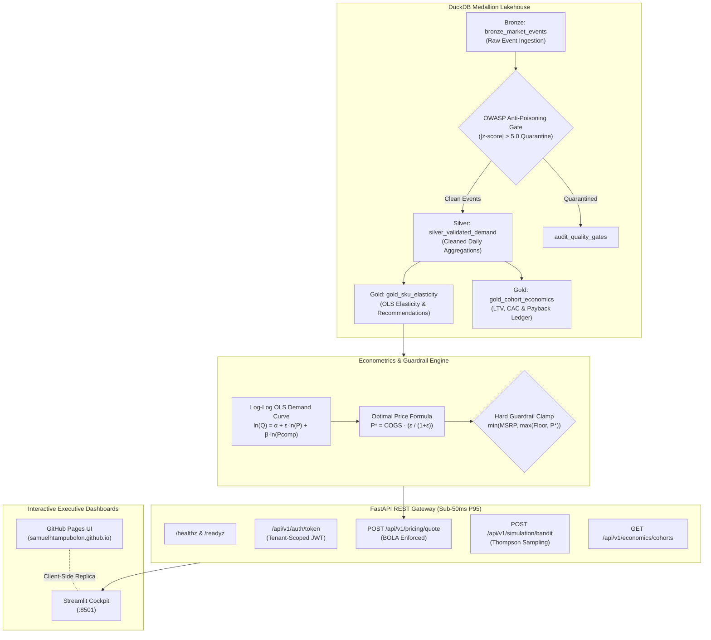

# ⚡ Real-Time Dynamic Pricing & Unit Economics Engine

[](https://www.python.org/downloads/)
[](https://fastapi.tiangolo.com)
[](https://duckdb.org)
[](https://streamlit.io)
[](https://owasp.org/www-project-api-security/)
[](tests/)

An enterprise-grade, locally runnable **Real-Time Dynamic Pricing and Unit Economics Engine** built with **FastAPI**, an embedded **DuckDB Medallion Lakehouse** (`Bronze` $\to$ `Silver` $\to$ `Gold`), **Scikit-Learn Econometric Elasticity Models**, **Multi-Armed Bandit Experimentation (Thompson Sampling & Epsilon-Greedy)**, and a **Streamlit Executive Cockpit**.

---

## 🌐 Live Interactive Demonstration

- **GitHub Repository**: [https://github.com/samuelhtampubolon/dynamic-pricing-engine](https://github.com/samuelhtampubolon/dynamic-pricing-engine)
- **Interactive Web App (GitHub Pages)**: **[https://samuelhtampubolon.github.io/dynamic-pricing-engine/](https://samuelhtampubolon.github.io/dynamic-pricing-engine/)**

---

## 🏛️ System Architecture



---

## 📐 Unit Economics Governing Equations

| Metric / Objective | Mathematical Formulation | Business Implication |
| :--- | :--- | :--- |
| **Price Elasticity of Demand ($\epsilon$)** | $\epsilon = \frac{dQ / Q}{dP / P}$ estimated via OLS on $\ln(Q) = \alpha + \epsilon \ln(P) + \beta \ln(P_{\text{comp}})$ | Quantifies buyer sensitivity to price fluctuations. |
| **Optimal Unconstrained Price ($P^*$)** | $P^* = \text{unit\_cogs} \cdot \left(\frac{\epsilon}{1 + \epsilon}\right) \quad (\text{for } \epsilon < -1.0)$ | Microeconomic Lerner Index profit-maximizing price. |
| **Guarded Recommended Price** | $P_{\text{rec}} = \min\left(\text{max\_msrp}, \max\left(\text{unit\_cogs} \cdot (1 + \text{min\_margin\_pct}), P^*\right)\right)$ | **Non-bypassable circuit breaker** preventing negative margin and price gouging. |
| **Customer Lifetime Value (LTV)** | $\text{LTV} = \frac{\text{ARPU}_{\text{monthly}} \cdot \text{Gross Margin \%}}{\text{Monthly Churn Rate}}$ | Total net contribution expected over customer life. |
| **LTV to CAC Ratio** | $\text{LTV / CAC} = \frac{\text{LTV}}{\text{CAC}_{\text{usd}}}$ | Capital efficiency metric (Target $> 3.0\times$). |
| **CAC Payback Period** | $\text{Payback Months} = \frac{\text{CAC}_{\text{usd}}}{\text{ARPU}_{\text{monthly}} \cdot \text{Gross Margin \%}}$ | Time required to recoup customer acquisition investment. |

---

## 🛡️ OWASP API Security & Guardrails

1. **OWASP API1: Broken Object Level Authorization (BOLA)**: Every SKU and cohort route validates that the JWT `tenant_id` claim strictly matches the requested entity tenant. Cross-tenant access attempts immediately fail with `HTTP 403 Forbidden`.
2. **OWASP API3: Mass Assignment Prevention**: All Pydantic v2 schemas declare `model_config = ConfigDict(extra='forbid')` and enforce strict bounds (`gt=0`, `le=1000000`, `allow_inf_nan=False`). Injected or unknown attributes are rejected with `HTTP 422`.
3. **OWASP API4: Unrestricted Resource Consumption**: Simulation iterations are capped at `max_horizon=5000` per API call and protected with `slowapi` rate limiting.
4. **Algorithmic Anti-Poisoning Gate**: Detects and quarantines synthetic or adversarial outliers where price or volume deviates by more than $5.0$ standard deviations ($|z| > 5.0$) before promoting raw Bronze events to Silver daily demand aggregations.
5. **SQL Injection Defense**: Uses 100% parameterized SQL query bindings on DuckDB (`?` placeholders).
6. **Defense-in-Depth Headers**: Injects `X-Content-Type-Options: nosniff`, `X-Frame-Options: DENY`, `Content-Security-Policy: default-src 'self'`, and `Strict-Transport-Security`.

---

## 🚀 Quickstart & Local Live Server

### Single-Command Startup
```bash
# 1. Install dependencies
pip install -r requirements.txt

# 2. Run deterministic preflight health check
python run_local.py --check

# 3. Launch live servers (FastAPI + Streamlit concurrently)
python run_local.py
```

### Server Access Endpoints
- **Streamlit Executive Cockpit**: [http://127.0.0.1:8501](http://127.0.0.1:8501)
- **FastAPI Interactive Swagger Docs**: [http://127.0.0.1:8000/docs](http://127.0.0.1:8000/docs)
- **FastAPI ReDoc Documentation**: [http://127.0.0.1:8000/redoc](http://127.0.0.1:8000/redoc)
- **Health Liveness Probe**: [http://127.0.0.1:8000/healthz](http://127.0.0.1:8000/healthz)
- **Lakehouse Readiness Probe**: [http://127.0.0.1:8000/readyz](http://127.0.0.1:8000/readyz)

---

## 🧪 Verification & Automated Testing

Run the full automated test suite containing 14 comprehensive checks:
```bash
pytest -v
```

### Verified Test Results (100% Passed)
```text
tests/test_api_security.py::test_healthz_and_readyz_probes PASSED        [  7%]
tests/test_api_security.py::test_jwt_token_issuance_and_access PASSED    [ 14%]
tests/test_api_security.py::test_owasp_api1_bola_cross_tenant_isolation PASSED [ 21%]
tests/test_api_security.py::test_owasp_api2_broken_authentication PASSED [ 28%]
tests/test_api_security.py::test_owasp_api3_mass_assignment_extra_fields PASSED [ 35%]
tests/test_api_security.py::test_owasp_api3_numeric_bounds_validation PASSED [ 42%]
tests/test_api_security.py::test_owasp_api4_resource_consumption_cap PASSED [ 50%]
tests/test_api_security.py::test_owasp_security_headers_injection PASSED [ 57%]
tests/test_pricing_guardrails.py::test_margin_floor_circuit_breaker_cannot_be_violated PASSED [ 64%]
tests/test_pricing_guardrails.py::test_msrp_ceiling_guardrail_cannot_be_exceeded PASSED [ 71%]
tests/test_pricing_guardrails.py::test_anti_poisoning_quality_gate_quarantines_anomalies PASSED [ 78%]
tests/test_pricing_guardrails.py::test_unit_economics_governing_equations PASSED [ 85%]
tests/test_pricing_guardrails.py::test_bandit_simulation_thompson_sampling PASSED [ 92%]
tests/test_pricing_guardrails.py::test_bandit_simulation_epsilon_greedy PASSED [100%]

============================= 14 passed in 5.98s ==============================
```

---

## 📂 Project Repository Layout

```text
├── ADR.md                                # Architectural Decision Records (Lakehouse, Econometrics, OWASP)
├── Dockerfile                            # Production multi-stage container
├── docker-compose.yml                    # Multi-container orchestration (API + UI)
├── Makefile                              # Development task automation commands
├── README.md                             # Architecture, equations, and verification docs
├── requirements.txt                      # Python dependencies
├── run_local.py                          # Unified single-command launcher with --check flag
├── .env.example                          # Environment configuration template
├── data/
│   └── pricing_lakehouse.duckdb          # Embedded DuckDB Medallion storage
├── docs/
│   └── index.html                        # GitHub Pages interactive web application
├── src/
│   ├── __init__.py
│   ├── config.py                         # Settings & environment variables
│   ├── security.py                       # JWT token lifecycle, OWASP BOLA, rate limits
│   ├── schemas.py                        # Pydantic v2 schemas (extra='forbid')
│   ├── lakehouse.py                      # DuckDB Medallion Lakehouse manager & quality gates
│   ├── seed_market_data.py               # 12-month synthetic multi-SKU market events generator
│   ├── services/
│   │   ├── elasticity_model.py           # Log-log OLS elasticity & guarded pricing optimizer
│   │   ├── bandit_simulator.py           # Thompson Sampling & Epsilon-Greedy MAB simulator
│   │   └── unit_economics.py             # Cohort LTV/CAC & payback metrics
│   ├── api/
│   │   ├── main.py                       # FastAPI entrypoint with health & readyz probes
│   │   └── routes_pricing.py             # Tenant-scoped pricing, bandit, & cohort endpoints
│   └── ui/
│       └── dashboard.py                  # Streamlit 1.40+ Executive Control Tower
└── tests/
    ├── test_pricing_guardrails.py        # Margin floor circuit breaker & econometric tests
    └── test_api_security.py              # OWASP Top 10 API security & BOLA isolation tests
```

---

## 📜 License
MIT License. Built for modern high-velocity marketplaces and revenue operations teams.
